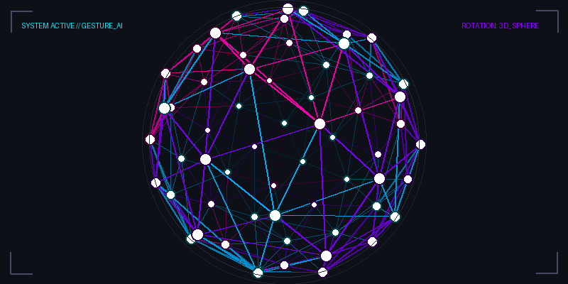

<div align="center">


  <!-- Animated Typing SVG (Single-line dynamic typewriter cycle - never overlaps or cuts off) -->
  <p align="center">
    
  </p>

  <br/>

  <!-- Banner GIF with Clean Rounded Styling & Box Shadow -->
  <p align="center">
    
  </p>

  <!-- Social Quick Links -->
  <p align="center">
    <a href="https://krishna-gupta-portfolio.vercel.app" target="_blank">
      
    </a>
    <a href="https://linkedin.com/in/krishna-gupta333" target="_blank">
      
    </a>
    <a href="mailto:16krishnagupta06@gmail.com">
      
    </a>
    <a href="https://instagram.com/1k.r.i.s.h.n.a._" target="_blank">
      
    </a>
  </p>

</div>

---

### ⚡ Executive Summary

```yaml
Name: Krishna Gupta
Focus: Artificial Intelligence, Computer Vision & Edge Systems
Degree: B.Tech in AI & Data Science (2024–2028)
Institution: Arya College of Engineering & IT, Jaipur
Location: Jaipur, Rajasthan, India
Status: Open for AI/ML Internships & High-Impact Open Source Collaborations
```

- 🧠 **Primary Focus**: Designing gesture-controlled human-computer interaction (HCI), vector-similarity search pipelines, and automated intelligence agents.
- 🎯 **Engineering Philosophy**: Building resilient systems that make complex AI feel instantaneous and seamless to use.
- 🔭 **Current Deep Dive**: Sub-millisecond vector indexing with **Qdrant**, edge model quantization, and distributed AI pipelines.

---

### 🚀 Flagship Engineering Projects

<table>
  <tr>
    <td width="50%" valign="top">
      <h3>🖐️ <a href="https://github.com/KrishnaGupta-coder/ZeroTouchSec">ZeroTouchSec</a></h3>
      <p><b>Gesture-Driven AI & Touchless System Automation</b></p>
      <ul>
        <li>HCI framework that enables complete system-level operation using real-time computer vision without physical contact.</li>
        <li>Combines <b>PyTorch</b> and <b>OpenCV</b> for low-latency posture tracking, custom gesture triggers, and secure surveillance.</li>
      </ul>
      <p>
        
        
        
      </p>
    </td>
    <td width="50%" valign="top">
      <h3>🛰️ <a href="https://github.com/KrishnaGupta-coder/SDA---Smart-Disaster-Agent">Smart Disaster Agent (SDA)</a></h3>
      <p><b>Predictive AI for Satellite & Live Crisis Response</b></p>
      <ul>
        <li>Real-time hazard prediction engine analyzing satellite telemetry and live sensor streams to predict natural hazards.</li>
        <li>Generates automated emergency dispatch suggestions and evacuation routing corridors during crisis events.</li>
      </ul>
      <p>
        
        
        <a href="https://sda-smart-disaster-agent.vercel.app/" target="_blank"></a>
      </p>
    </td>
  </tr>
  <tr>
    <td width="50%" valign="top">
      <h3>🏛️ <a href="https://github.com/KrishnaGupta-coder/JavaLabPortal">JavaLabPortal</a></h3>
      <p><b>Enterprise 3-Tier MVC Dynamic Academic Portal</b></p>
      <ul>
        <li>Robust role-based portal built on Java EE architecture with JSP, Servlets, and connection-pooled JDBC.</li>
        <li>Full student and faculty management, automated grade feedback loops, and production-deployed containerized setup.</li>
      </ul>
      <p>
        
        
        <a href="https://javalabportal-production.up.railway.app" target="_blank"></a>
      </p>
    </td>
    <td width="50%" valign="top">
      <h3>🧬 <a href="https://github.com/KrishnaGupta-coder/Artificial-Life-Simulator">Artificial Life Simulator</a></h3>
      <p><b>Biological Simulation & Evolutionary Algorithms in C</b></p>
      <ul>
        <li>High-performance simulation of autonomous biological agents navigating environmental pressures and resource constraints.</li>
        <li>Implements custom genetic drift, natural selection mechanisms, and real-time state calculation in pure low-level C.</li>
      </ul>
      <p>
        
        
        
      </p>
    </td>
  </tr>
</table>

---

### 🛠️ Technical Arsenal

<div align="center">

| Domain | Technologies & Frameworks |
| :--- | :--- |
| **Artificial Intelligence & Computer Vision** | `PyTorch` `TensorFlow` `OpenCV` `MediaPipe` `Qdrant Vector DB` `NumPy` `Pandas` `Scikit-Learn` |
| **Languages & Systems Programming** | `Python` `C++` `C` `Java` `TypeScript` `JavaScript` `SQL` |
| **Full Stack & Modern Web** | `React` `Next.js` `Node.js` `Express.js` `Java EE / JSP / Servlets` `HTML5` `CSS3` `TailwindCSS` |
| **Databases & Vector Storage** | `Qdrant` `PostgreSQL` `MySQL` `MongoDB` `JDBC` |
| **DevOps, Tools & Cloud** | `Git` `GitHub Actions` `Docker` `Linux` `Vercel` `Railway` `VS Code` `Jupyter` |

<br/>

<!-- Modern Badge Stack -->
<p align="center">
  
</p>

</div>

---

### 🐍 Dynamic Contribution Snake

<!-- Snake contribution graph animated automatically via GitHub Actions -->
<div align="center">
  <picture>
    <source media="(prefers-color-scheme: dark)" srcset="https://raw.githubusercontent.com/KrishnaGupta-coder/KrishnaGupta-coder/output/github-contribution-grid-snake-dark.svg">
    <source media="(prefers-color-scheme: light)" srcset="https://raw.githubusercontent.com/KrishnaGupta-coder/KrishnaGupta-coder/output/github-contribution-grid-snake.svg">
    
  </picture>
</div>

---

### 📊 Real-Time GitHub Analytics

<div align="center">
  <table border="0">
    <tr>
      <td align="center">
        
      </td>
      <td align="center">
        
      </td>
    </tr>
    <tr>
      <td colspan="2" align="center">
        
      </td>
    </tr>
  </table>
</div>

---

<div align="center">
  <sub>Designed with precision & dynamic automation • Crafted for <b>Krishna Gupta</b> • Jaipur, India</sub>
</div>
<!-- Co-authored with Devansh Joshi for open source collaboration -->
